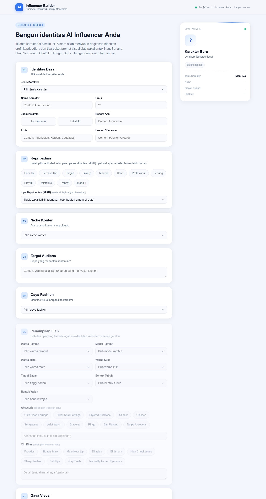

# AI Influencer Builder

Halaman tunggal untuk membangun identitas AI Influencer. Buat profil influencer berbasis AI: identitas, kepribadian, niche, audiens, gaya, dan tujuan — lalu dapatkan ringkasan identitas dan tiga paket prompt visual siap pakai untuk NanoBanana, Flux, Seedream, ChatGPT Image, dan Gemini Image.

## Screenshot

## Cara pakai

Buka `index.html` di browser. Isi form di halaman, hasilnya langsung muncul di bagian bawah.

## Struktur halaman

- Identitas Dasar
- Kepribadian
- Niche Konten
- Target Audiens
- Gaya Fashion
- Penampilan Fisik
- Gaya Visual
- Jenis Konten
- Platform Utama
- Tujuan AI Influencer

Preview default: `dibot`.
