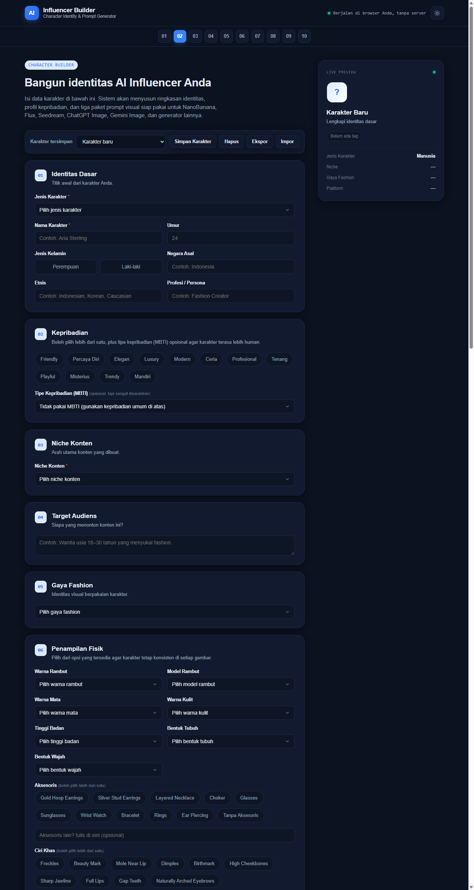

# AI Influencer Builder

Halaman tunggal untuk membangun identitas AI Influencer. Buat profil influencer berbasis AI: identitas, kepribadian, niche, audiens, gaya, dan tujuan — lalu dapatkan ringkasan identitas dan tiga paket prompt visual siap pakai untuk NanoBanana, Flux, Seedream, ChatGPT Image, dan Gemini Image.

## Screenshot

Mode gelap:

## Cara pakai

Buka `index.html` di browser. Isi form di halaman, hasilnya langsung muncul di bagian bawah.

Fitur:

- **Autosave** — isi form tersimpan otomatis (debounce 400 ms) dan pulih saat halaman dimuat ulang.
- **Validasi** — tiga field wajib (jenis karakter, nama, niche) ditandai `*`; Generate terblokir sampai terisi.
- **Navigasi bagian** — pill nomor bagian di bawah header (desktop) dan tombol Sebelumnya/Berikutnya di bawah (mobile).
- **Mode gelap** — tombol di header, mengikuti preferensi sistem saat pertama dibuka.
- **Beberapa karakter** — simpan, ganti, hapus, ekspor, dan impor profil karakter (JSON).

## Struktur halaman

- Identitas Dasar
- Kepribadian
- Niche Konten
- Target Audiens
- Gaya Fashion
- Penampilan Fisik
- Gaya Visual
- Jenis Konten
- Platform Utama
- Tujuan AI Influencer

Preview default: `dibot`.
